<div align="center">

# Sklad Pro · «Склад ПРО»

**Warehouse management desktop app for Windows** · **Десктоп-приложение для складского учёта**

A complete replacement of the Excel workbook «Склад ПРО 7.1»: reference books, five document types, real-time stock, registries, printable invoices, six reports, user roles, backups and one-click 7.1 data migration — all in a single Windows application.

Полная замена Excel-файла «Склад ПРО 7.1»: справочники, пять типов документов, остатки в реальном времени, реестры, печатные накладные, шесть отчётов, роли пользователей, бэкапы и миграция данных из 7.1 в один клик — в одном Windows-приложении.

[](https://www.python.org/)
[](https://fastapi.tiangolo.com/)
[](https://react.dev/)
[](https://www.typescriptlang.org/)
[](https://www.sqlite.org/)
[](https://www.electronjs.org/)
[]
[]
[](LICENSE)

**Stable · v1.0.1**

**Language: [English](#english) | [Русский](#русский)**

</div>

---

# English

## Overview

**Sklad Pro** (Russian: «Склад ПРО») is a desktop warehouse-inventory application for Windows, built as a direct replacement of the classic Excel/VBA workbook *Склад ПРО 7.1*. It covers the full day-to-day workflow of a warehouse: nomenclature and reference books, five document types (receipt, issue, write-off, transfer, inventory), live stock per warehouse, registries with printable invoices in the familiar 7.1 layout, six report types with XLSX/PDF export, user roles with an audit log, database backups — and a one-click migration of data from the old 7.1 file, including stock reconciliation.

The app ships as **one Windows executable** (portable or installer). The UI (React) and a local server (FastAPI + SQLite) run together inside it, so it works out of the box on a single PC — or in **network mode**, where one PC hosts the server and any number of workers connect with the app or a plain browser. The database file is never shared over the network; only the HTTP API is.

## Screenshots

| | |
|---|---|
| 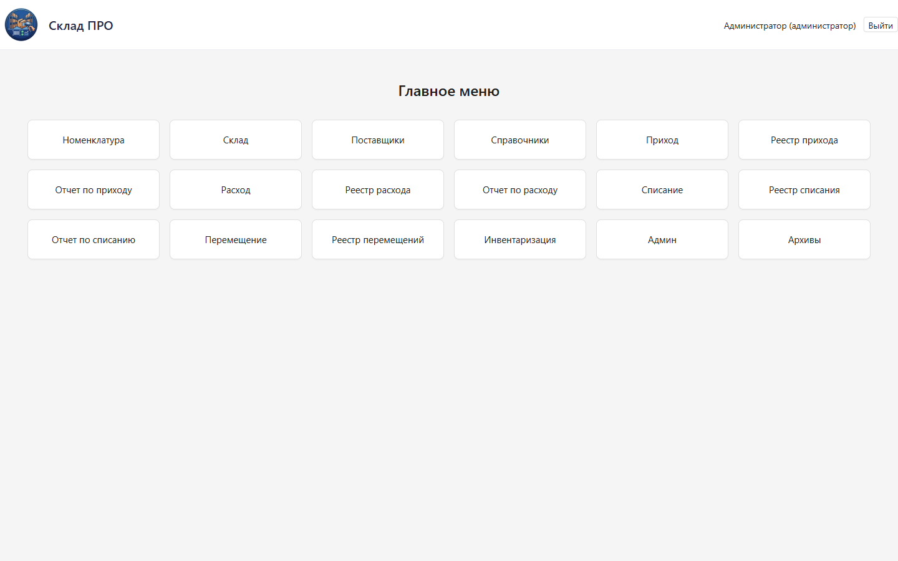 | 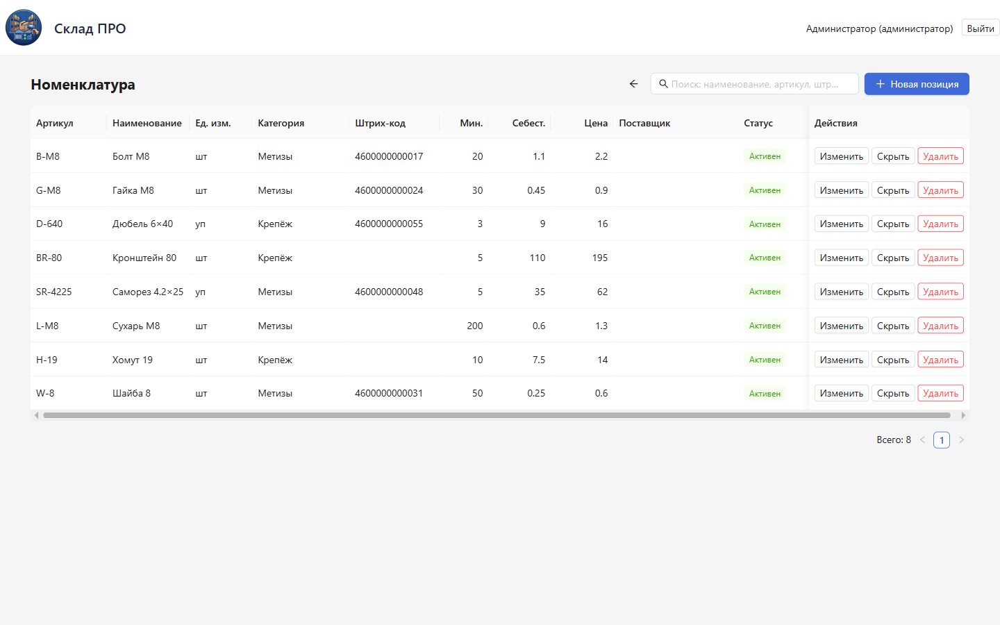 |
| **Main menu** — the familiar 7.1 button grid | **Nomenclature** — search, SKUs, barcodes, prices |

The full set:

| | | |
|---|---|---|
|  | 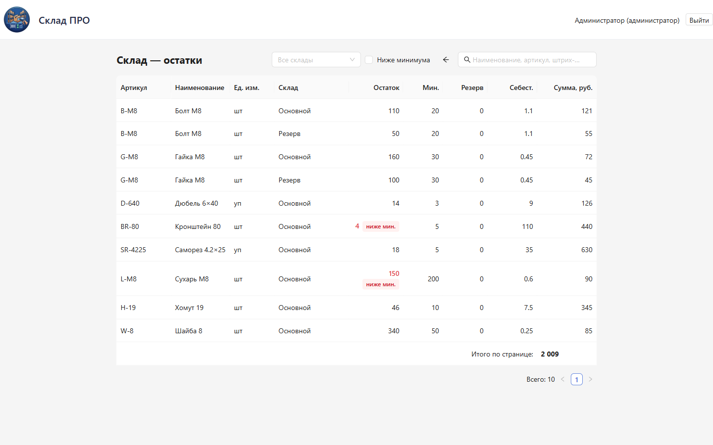 | 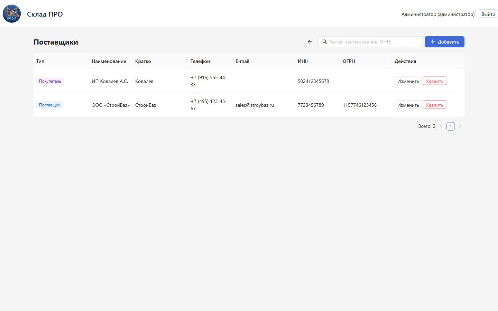 |
| Login | Stock (below-minimum highlighted) | Suppliers & customers |
| 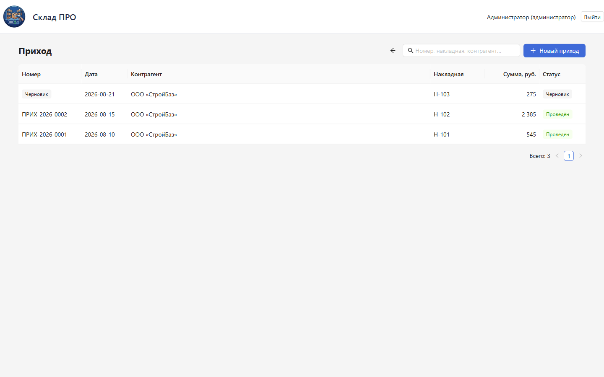 | 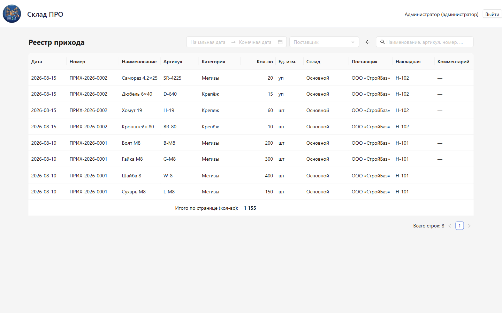 | 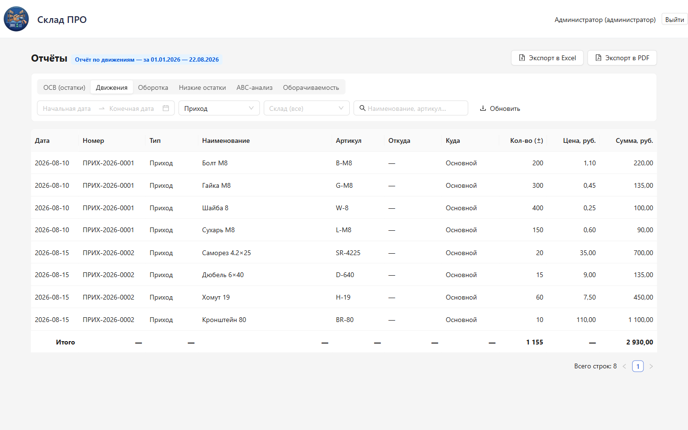 |
| Receipt document (draft) | Receipt registry | Receipt report |
| 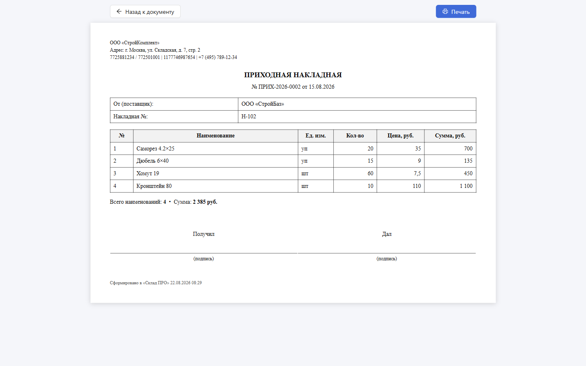 | 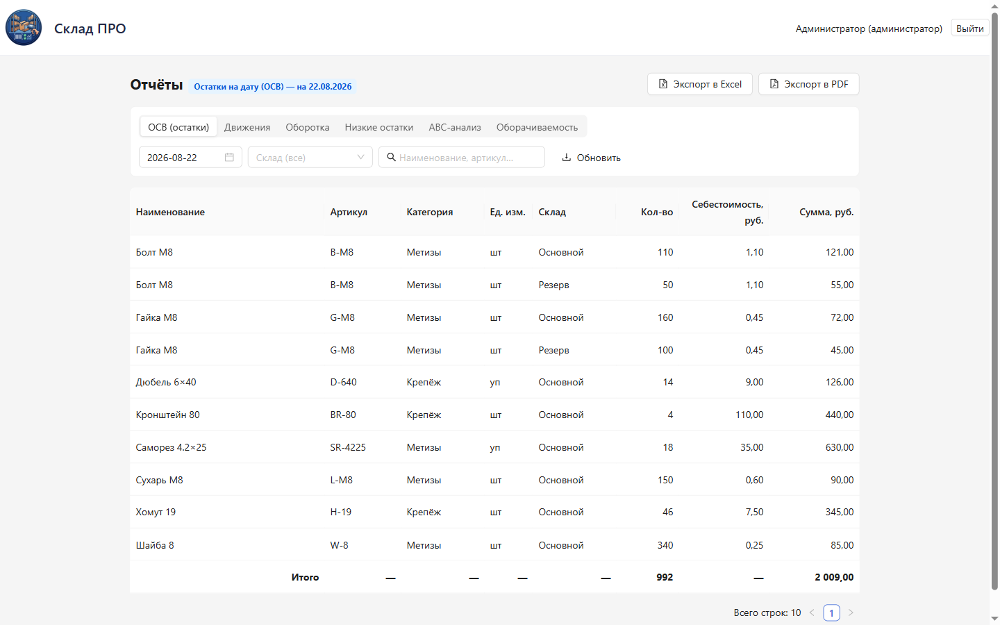 | 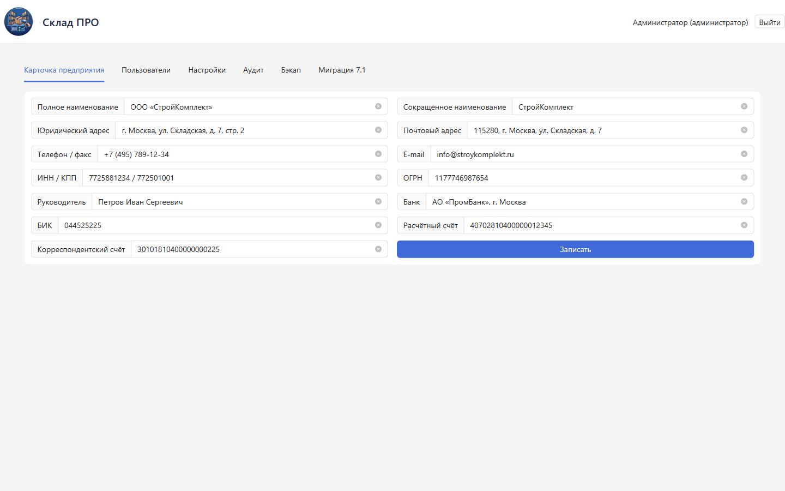 |
| Printable issue invoice (7.1 layout) | Reports (balance sheet) | Admin: company card |
| 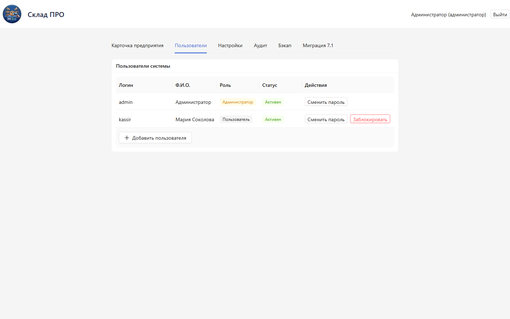 | 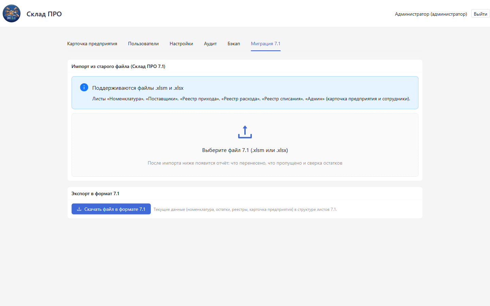 | |
| Admin: users & roles | Admin: 7.1 migration (import/export) | |

## Features

### Reference books

- **Nomenclature** — name, article (SKU), barcode, unit, category, minimum stock level, cost price, sale price, default supplier, active/hidden status. Search by name, SKU or barcode.
- **Warehouses** — any number; every stock line and document line is bound to a warehouse.
- **Suppliers & customers** — full cards: legal/short name, address, phone, e-mail, INN, OGRN.
- **Categories and units** — free-form lists used by nomenclature.

### Documents (5 types)

**Receipt · Issue · Write-off · Transfer · Inventory**

- Document lifecycle: *draft → «Post» → posted*. A posted document can be cancelled, with stock changes rolled back automatically.
- **Create based on** — a new document is pre-filled from any posted one (e.g. a receipt from a previous receipt).
- Automatic sequential numbers (`IN-2026-0001`, `OUT-2026-0001`, …), document date, invoice reference, counterparty, “issued by / received by” fields.
- Validation: quantity > 0, stock checks with a **configurable negative-stock rule**, per-line notes.
- **Inventory**: counted quantities per item; after posting, the difference between counted and book stock is applied to the balances automatically (rolled back when the document is cancelled).

### Stock

- Live balances per item and warehouse (plus grand totals), valued at cost price.
- **Minimum stock levels**: items below the minimum are highlighted in red and can be isolated with the “Below minimum” filter.

### Registries, printing, archives

- Registries for all five document types: number, date, counterparty, amount, status (*draft / posted*), open document, cancel document.
- **Printable invoices in the classic 7.1 layout** — company header, From/To block, item table, “Issued by / Received by” signature lines. Print to a printer or save as PDF straight from the browser.
- **Archives** — quick access to all posted documents of every type.

### Reports (6 types)

| Report | What it answers |
|---|---|
| Balance sheet (ОСВ) | What is on the shelf today, per warehouse, at cost and sale price |
| Movements | What came in / went out in a period, by document type |
| Turnover | Incoming and outgoing per item for a period |
| Low stock | Items below their minimum level |
| ABC analysis | Items classified by turnover share |
| Turnover speed | How long the current stock will last |

Every report: period / warehouse / document-type filters, pagination, **XLSX** and **PDF** export (PDF supports Cyrillic), printing.

### Administration

- **Company card** — the data printed on every invoice (INN/KPP, OGRN, bank details, director).
- **Users & roles** — `admin` and `user` roles; the Admin section is hidden from non-admins; password management.
- **Settings** — e.g. allow/deny negative stock.
- **Audit log** — who did what and when: logins, posting/cancelling documents, imports, settings changes.
- **Backups** — create and restore a full database backup.

### Migration from «Склад ПРО 7.1»

- **Import** `.xlsm` / `.xlsx`: sheets *Nomenclature, Suppliers, Receipt registry, Issue registry, Write-off registry, Admin* (company card + employees).
- After the import — a detailed report: what was imported, what was skipped, and a **stock reconciliation** between the old file and the new database.
- **Export back to the 7.1 format** — current data (nomenclature, stock, registries, company card) in the 7.1 sheet structure, so the old file can always serve as a fallback.

### Desktop & network modes

- One executable: **portable** (runs from a folder or a USB stick) or **Setup** (NSIS installer with Start-menu entry).
- **Local mode** — the app starts its own server on `127.0.0.1:8700`; zero configuration.
- **Network mode** — one PC runs the server; every other worker opens the app (or a regular browser) at `http://<server-ip>:8700`. Only the API is exposed — the database file is never shared.

## Architecture

```
                     Sklad Pro — one Windows application
┌───────────────────────────────────────────────────────────────────────────┐
│  Electron shell                                                          │
│  ┌───────────────────────────┐        ┌────────────────────────────────┐  │
│  │  UI — React 19            │  HTTP  │  sklad-server.exe              │  │
│  │  TypeScript, Ant Design 6 │◄─────►│  FastAPI + SQLAlchemy 2.0      │  │
│  │  (bundled web/dist)       │ :8700 │  SQLite, WAL mode              │  │
│  └───────────────────────────┘        │  %LOCALAPPDATA%\SkladPro\data │  │
│                                       └────────────────────────────────┘  │
└───────────────────────────────────────────────────────────────────────────┘
        Network mode — other PCs:
        app or browser ──► http://<server-ip>:8700   (HTTP API only, DB is never shared)
```

## Tech stack

| Layer | Technologies |
|---|---|
| Backend | Python 3.14 · FastAPI · SQLAlchemy 2.0 · Pydantic v2 · uvicorn |
| Database | SQLite (WAL mode) — a single file, no database server needed |
| Security | JWT (PyJWT) · PBKDF2 password hashing |
| Import / export | openpyxl (.xlsx) · reportlab (PDF with Cyrillic) |
| Frontend | React 19 · TypeScript · Vite 8 · Ant Design 6 (ru-RU locale) |
| Desktop | Electron 37 · electron-builder (portable + NSIS) · PyInstaller |
| Tests | pytest — 50 tests, all green |

## Quick start

1. **Download** the distribution from [Releases](https://github.com/Prophetic-Helgy/sklad-pro/releases):
   - **Setup** — installer (Start menu, desktop shortcut);
   - **portable** — a single file, run it from any folder or a USB stick.
2. **First run.** The app starts its built-in server (local mode) or asks for the server address (network mode). Default account: **admin / 1234** — change the password right away (Admin → Users).
3. **Move from 7.1.** Admin → *Migration 7.1* → pick your old `.xlsm` file → check the import report and stock reconciliation.
4. **Development mode** (from this repository): run `dev.bat` (requires Python 3.14 and Node 20+) — API at `http://127.0.0.1:8700`, Vite UI at `http://127.0.0.1:5173`, data stored in `data/dev`.

## Data & backups

- The database lives at `%LOCALAPPDATA%\SkladPro\data\склад.db`. It is created automatically on first run and seeded with the `admin` user and the default warehouse.
- **Admin → Backups** — create a backup of the whole database and restore it when needed. A backup before a 7.1 import is a good habit.
- Moving to another PC: copy the `data` folder (or restore a backup) and the app is up with all history.

## Project structure

```
sklad-pro/
├── server/                 # FastAPI backend
│   ├── app/                #   API, models, posting engine, reports, 7.1 migration
│   ├── tests/              #   pytest suite (50 tests)
│   ├── server_entry.py     #   entry point for the packaged server
│   └── requirements.txt
├── web/                    # React 19 + Vite + Ant Design 6 frontend
├── packaging/
│   ├── sklad-server.spec   # PyInstaller spec (onedir)
│   ├── electron/           # Electron shell, electron-builder config, icon
│   └── build.bat           # full rebuild: web dist → server exe → distributives
├── docs/                   # 7.1 workbook analysis; install & run guide (RU)
├── assets/screenshots/     # screenshots used in this README
├── dev.bat                 # development launch (uvicorn + vite)
└── README.md
```

## About the project

«Склад ПРО» was created as a direct replacement of the Excel workbook *Склад ПРО 7.1*, which many small warehouses have been running on for years. What the new app brings: a native application instead of a macro file (no “macro security” prompts, no Excel versions to worry about), reliable stock based on database transactions, user roles and an audit log, configurable negative-stock control, printable invoices in the familiar 7.1 layout, reports with XLSX/PDF export, and a one-way street out of 7.1 — import, reconcile, done.

## License

Proprietary, source-available. The current release (v1.0.x) is **free for personal and commercial use**; all other rights are reserved, and future versions/editions may be released under paid terms. See the [LICENSE](LICENSE) file for the full text.

**Copyright © 2026. All rights reserved.**

---

# Русский

## Обзор

**«Склад ПРО»** — десктоп-приложение складского учёта для Windows, созданное как прямая замена классической Excel-книги *Склад ПРО 7.1*. Оно закрывает весь ежедневный цикл склада: номенклатура и справочники, пять типов документов (приход, расход, списание, перемещение, инвентаризация), остатки по складам в реальном времени, реестры с печатными накладными в привычном макете 7.1, шесть отчётов с экспортом в XLSX/PDF, роли пользователей с журналом аудита, бэкапы базы — и миграция данных из старого файла 7.1 в один клик со сверкой остатков.

Приложение поставляется **одним Windows-файлом** (портативным или установщиком). Интерфейс (React) и локальный сервер (FastAPI + SQLite) работают внутри него вместе: программа запускается «из коробки» на одном ПК — или в **сетевом режиме**, где сервер стоит на одной машине, а все остальные рабочие места подключаются приложением или обычным браузером. Файл базы данных по сети не шарится — наружу открывается только HTTP API.

## Скриншоты

| | |
|---|---|
|  |  |
| **Главное меню** — привычная сетка кнопок 7.1 | **Номенклатура** — поиск, артикулы, штрих-коды, цены |

Полный комплект:

| | | |
|---|---|---|
|  |  |  |
| Вход | Склад (подсвечены остатки ниже минимума) | Поставщики и клиенты |
|  |  |  |
| Документ «Приход» (черновик) | Реестр прихода | Отчёт по приходу |
|  |  |  |
| Печатная расходная накладная (макет 7.1) | Отчёты (ОСВ) | Админ: карточка предприятия |
|  |  | |
| Админ: пользователи и роли | Админ: миграция 7.1 (импорт/экспорт) | |

## Функционал

### Справочники

- **Номенклатура** — наименование, артикул, штрих-код, единица измерения, категория, минимальный остаток, себестоимость, цена продажи, поставщик по умолчанию, статус «активен/скрыт». Поиск по названию, артикулу, штрих-коду.
- **Склады** — сколько нужно; каждая строка остатков и документов привязана к складу.
- **Поставщики и клиенты** — полные карточки: полное/сокращённое наименование, адрес, телефон, e-mail, ИНН, ОГРН.
- **Категории и единицы измерения** — свободные списки, используются в номенклатуре.

### Документы (5 типов)

**Приход · Расход · Списание · Перемещение · Инвентаризация**

- Жизненный цикл: *черновик → «Записать (провести)» → проведён*. Проведённый документ можно отменить — остатки откатываются автоматически.
- **Создание на основании** — новый документ предзаполняется из любого проведённого (например, приход на основании прошлого прихода).
- Автоматические последовательные номера (`ПРИХ-2026-0001`, `РАСХ-2026-0001`, …), дата документа, № накладной, контрагент, поля «отпустил / получил».
- Валидация: количество > 0, контроль остатков с **настраиваемым правилом отрицательного остатка**, примечание к строке.
- **Инвентаризация**: фактические количества по позициям; после проведения расхождения факта и книжного остатка автоматически отражаются в остатках (при отмене проведения — откатываются).

### Остатки

- Остатки по товарам и складам в реальном времени (плюс итоги), оценка по себестоимости.
- **Минимальный остаток**: позиции ниже минимума подсвечиваются красным и выделяются фильтром «Ниже минимума».

### Реестры, печать, архивы

- Реестры всех пяти типов документов: номер, дата, контрагент, сумма, состояние (*черновик / проведён*), открытие документа, отмена проведения.
- **Печатные накладные в классическом макете 7.1** — шапка предприятия, блок «От / Кому», таблица позиций, строки подписей «Отпустил / Получил». Печать на принтер или сохранение в PDF прямо из браузера.
- **Архивы** — быстрый доступ ко всем проведённым документам любого типа.

### Отчёты (6 типов)

| Отчёт | На что отвечает |
|---|---|
| ОСВ (остатки) | Что лежит на складе сегодня, по складам, в себестоимости и ценах |
| Движения | Что приходило / уходило за период, по типам документов |
| Оборотка | Приход и расход по каждой позиции за период |
| Низкие остатки | Позиции ниже минимального уровня |
| ABC-анализ | Разбор позиций по доле оборота |
| Оборачиваемость | На сколько дней хватит текущих остатков |

В каждом отчёте: фильтры по периоду, складу, типу документа, пагинация, экспорт в **XLSX** и **PDF** (PDF с кириллицей), печать.

### Администрирование

- **Карточка предприятия** — данные, попадающие на все печатные формы (ИНН/КПП, ОГРН, банковские реквизиты, руководитель).
- **Пользователи и роли** — роли `admin` и `user`; раздел «Админ» не виден не-админам; управление паролем.
- **Настройки** — например, разрешить/запретить отрицательный остаток.
- **Журнал аудита** — кто что сделал и когда: входы, проведение/отмена документов, импорты, изменения настроек.
- **Бэкапы** — создание и восстановление полной резервной копии базы.

### Миграция из «Склад ПРО 7.1»

- **Импорт** `.xlsm` / `.xlsx`: листы *Номенклатура, Поставщики, Реестр прихода, Реестр расхода, Реестр списания, Админ* (карточка предприятия и сотрудники).
- После импорта — подробный отчёт: что перенесено, что пропущено, и **сверка остатков** между старым файлом и новой базой.
- **Обратный экспорт в формат 7.1** — текущие данные (номенклатура, остатки, реестры, карточка предприятия) в структуре листов 7.1, чтобы старый файл всегда оставался запасным вариантом.

### Десктоп и сетевой режимы

- Один исполняемый файл: **portable** (работает из папки или флешки) или **Setup** (установщик NSIS, пункт в меню «Пуск»).
- **Локальный режим** — приложение само поднимает сервер на `127.0.0.1:8700`, настройка не нужна.
- **Сетевой режим** — сервер работает на одном ПК, остальные рабочие места открывают приложение (или обычный браузер) по адресу `http://<ip-сервера>:8700`. По сети открыт только API, файл базы данных не шарится.

## Архитектура

```
                     Склад ПРО — одно Windows-приложение
┌───────────────────────────────────────────────────────────────────────────┐
│  Оболочка Electron                                                       │
│  ┌───────────────────────────┐        ┌────────────────────────────────┐  │
│  │  Интерфейс — React 19     │  HTTP  │  склад-server.exe              │  │
│  │  TypeScript, Ant Design 6 │◄─────►│  FastAPI + SQLAlchemy 2.0      │  │
│  │  (встроенный web/dist)    │ :8700 │  SQLite, режим WAL             │  │
│  └───────────────────────────┘        │  %LOCALAPPDATA%\SkladPro\data │  │
│                                       └────────────────────────────────┘  │
└───────────────────────────────────────────────────────────────────────────┘
        Сетевой режим — другие ПК:
        приложение или браузер ──► http://<ip-сервера>:8700   (только HTTP API, база не шарится)
```

## Стек технологий

| Слой | Технологии |
|---|---|
| Бэкенд | Python 3.14 · FastAPI · SQLAlchemy 2.0 · Pydantic v2 · uvicorn |
| База данных | SQLite (режим WAL) — один файл, без сервера БД |
| Безопасность | JWT (PyJWT) · хеширование паролей PBKDF2 |
| Импорт / экспорт | openpyxl (.xlsx) · reportlab (PDF с кириллицей) |
| Фронтенд | React 19 · TypeScript · Vite 8 · Ant Design 6 (локаль ru-RU) |
| Десктоп | Electron 37 · electron-builder (portable + NSIS) · PyInstaller |
| Тесты | pytest — 50 тестов, все зелёные |

## Быстрый старт

1. **Скачайте** дистрибутив из [Releases](https://github.com/Prophetic-Helgy/sklad-pro/releases):
   - **Setup** — установщик (пункты в меню «Пуск» и на рабочем столе);
   - **portable** — один файл, запускается из любой папки или флешки.
2. **Первый запуск.** Приложение само поднимает встроенный сервер (локальный режим) или запрашивает адрес сервера (сетевой режим). Учётная запись по умолчанию: **admin / 1234** — смените пароль сразу (Админ → Пользователи).
3. **Перенос с 7.1.** Админ → *Миграция 7.1* → выберите старый файл `.xlsm` → проверьте отчёт об импорте и сверку остатков.
4. **Режим разработки** (из этого репозитория): запустите `dev.bat` (нужны Python 3.14 и Node 20+) — API на `http://127.0.0.1:8700`, интерфейс Vite на `http://127.0.0.1:5173`, данные лежат в `data/dev`.

## Данные и бэкапы

- База данных лежит в `%LOCALAPPDATA%\SkladPro\data\склад.db`. Создаётся автоматически при первом запуске и наполняется пользователем `admin` и складом по умолчанию.
- **Админ → Бэкап** — создание резервной копии всей базы и её восстановление. Бэкап перед импортом 7.1 — хорошая привычка.
- Перенос на другую машину: скопируйте папку `data` (или восстановите бэкап) — приложение заработает со всей историей.

## Структура проекта

```
sklad-pro/
├── server/                 # Бэкенд на FastAPI
│   ├── app/                #   API, модели, механизм проведения, отчёты, миграция 7.1
│   ├── tests/              #   набор тестов pytest (50 тестов)
│   ├── server_entry.py     #   точка входа упакованного сервера
│   └── requirements.txt
├── web/                    # Фронтенд: React 19 + Vite + Ant Design 6
├── packaging/
│   ├── sklad-server.spec   # Спецификация PyInstaller (onedir)
│   ├── electron/           # Electron-оболочка, конфиг electron-builder, иконка
│   └── build.bat           # полная пересборка: web dist → exe сервера → дистрибутивы
├── docs/                   # анализ книги 7.1; инструкция по установке и запуска (RU)
├── assets/screenshots/     # скриншоты, использованные в этом README
├── dev.bat                 # запуск в режиме разработки (uvicorn + vite)
└── README.md
```

## О проекте

«Склад ПРО» создан как прямая замена Excel-книги *Склад ПРО 7.1*, на которой многие небольшие склады работают годами. Что даёт новая программа: нативное приложение вместо макрос-файла (без вопросов «Безопасность макросов» и привязки к версии Excel), надёжные остатки на базе транзакций базы данных, роли пользователей и журнал аудита, настраиваемый контроль отрицательного остатка, печатные накладные в привычном макете 7.1, отчёты с экспортом в XLSX/PDF и односторонний выезд из 7.1 — импортировать, сверить, пользоваться.

## Лицензия

Проприетарная лицензия, исходный код открыт. Текущий релиз (v1.0.x) — **бесплатно для личных и коммерческих целей**; остальные права сохранены, будущие версии и издания могут выходить на платных условиях. Полный текст — в файле [LICENSE](LICENSE).

**Copyright © 2026. All rights reserved.**
